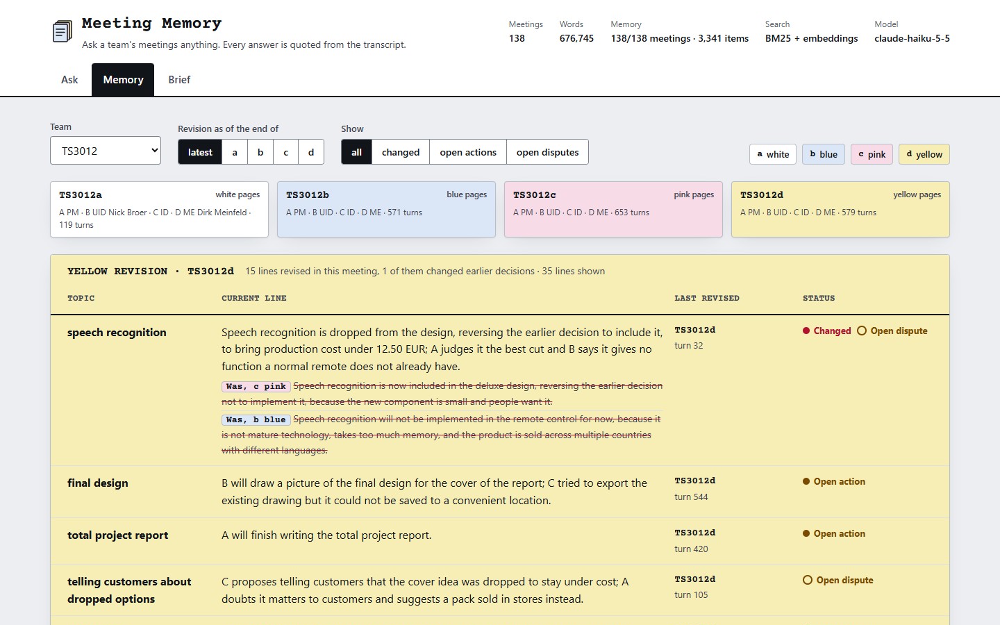

# Meeting Memory

An agent that turns meeting transcripts into **time-aware memory** you can question, and that writes a **pre-meeting brief**. Every quote it cites is checked by code to appear word for word in one speaker turn.

Built for the Catalist Agentic AI Intern build test (138 AMI meetings, 676,745 words, 25 questions, TS3012 brief).



*The Memory view: every line is tinted by the meeting that last revised it, earlier versions are struck through with the meeting that changed them, and clicking a line opens the exact transcript turn.*

- **How it works:** [docs/ARCHITECTURE.md](docs/ARCHITECTURE.md) · **one-page write-up:** [docs/WRITEUP.md](docs/WRITEUP.md)
- **Model vs code, and why:** [docs/DECISION_LOG.md](docs/DECISION_LOG.md)
- **Results and failures:** [docs/EVALUATION_REPORT.md](docs/EVALUATION_REPORT.md) · **status:** [docs/EXECUTION_STATUS.md](docs/EXECUTION_STATUS.md)

## Quick start

Requires Python 3.10+ (built on 3.11.9, Windows 11). Run all commands from the project root.

```powershell
pip install -r requirements.txt
```

Put the Catalist data in `data/` (the zip is not committed):

```powershell
Expand-Archive Catalist_AI_Intern_Build_Test_Data.zip -DestinationPath data
```

Add your key: copy `.env.example` to `.env` and set `ANTHROPIC_API_KEY`. Then make the package importable for this shell:

```powershell
$env:PYTHONPATH = "src"
```

| Step | Command | Needs key | Time / cost (measured) |
|---|---|---|---|
| Tests (no network) | `python -m pytest -q` | no | ~10 s |
| Parse + index only | `python -m meeting_memory ingest --no-extract` | no | ~9 s (+ embeddings, see below) |
| Full ingest (memory extraction) | `python -m meeting_memory ingest --report evaluation/results/ingest_report.json` | yes | ~25 min, ~$1.10 (Haiku 5.5; use `MM_INGEST_CONCURRENCY=4` to avoid rate limits) |
| Ask one question | `python -m meeting_memory ask "Team ES2002: what power source did they first agree on?"` | yes | |
| The submission | `python -m meeting_memory answer-all --concurrency 3` → `answers.json` (+ TS3012 brief) | yes | ~2 min, ~$0.05 |
| Brief only | `python -m meeting_memory brief --team TS3012` (`--no-llm` for the deterministic version) | optional | |
| Web UI | `python -m meeting_memory serve` → http://127.0.0.1:8765 | for Ask | |
| Check answers.json like the grader | `python -m meeting_memory.evaluate check-answers -v` | no | |
| Score our 12 gold questions | `python -m meeting_memory.evaluate gold --concurrency 3` | yes | ~1 min, ~$0.03 |
| Retrieval recall (BM25 / dense / hybrid) | `python -m meeting_memory.evaluate retrieval` | no | |
| Cost ledger | `python -m meeting_memory stats` | no | |
| Re-check speaker roles against direct address | `python -m meeting_memory resolve-roles` | no | seconds |

Embeddings are optional (`MM_EMBEDDINGS=0` for BM25 only). They use the local `all-MiniLM-L6-v2` from the Hugging Face cache and never download at runtime.

## What's where
```
src/meeting_memory/
  transcripts.py  chunking.py  store.py      parsing, chunks, SQLite + FTS5 (code only)
  quotes.py       roles.py     retrieval.py  citation verification, per-meeting roles, hybrid search (code only)
  memory.py                                  what is current / superseded / open (code only)
  extraction.py                              per-meeting memory extraction (the model)
  agent.py        tools.py                   bounded tool-use agent + read-only tools
  brief.py                                   pre-meeting brief (code picks facts, model writes prose)
  llm.py  ingest.py  cli.py  server.py  static/  evaluate.py
tests/            55 tests, no network (fake model backend)
evaluation/       gold_set.json (12 checked questions), results/
docs/             specification, architecture, decisions, evaluation, walkthrough
```

## Results at a glance
25/25 Catalist questions answered with **70/70 citations verbatim-valid**; TS3012 brief with 34/34 valid citations; our 12 hand-checked questions: **9 correct, 2 mostly correct, 1 wrong** (human read); ≈ **$8 per 1,000 meetings** to ingest; the whole build cost **$1.49** on Claude Haiku 5.5. Details and the three failures: [docs/EVALUATION_REPORT.md](docs/EVALUATION_REPORT.md).

## Known limitations
See [docs/EVALUATION_REPORT.md](docs/EVALUATION_REPORT.md) and [docs/FINAL_REVIEW.md](docs/FINAL_REVIEW.md). In short: speaker roles can still be wrong where letters swap and nobody is addressed by name (the IS1000d swap is corrected by a code-level resolver); "who first proposed X" can inherit an extraction mistake; memory quality depends on one extraction pass per meeting; the UI has no authentication (local use only).

## Data
AMI Meeting Corpus, University of Edinburgh and partners, CC BY 4.0, as reformatted by Catalist. Transcripts, questions and the brief are not committed to this repository.
