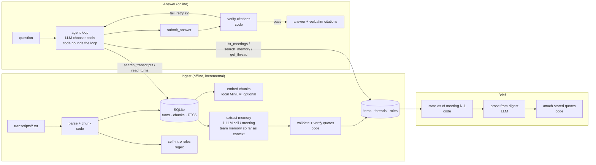

# Architecture

One Python package (`src/meeting_memory`), one SQLite file, one model provider. No vector database, no queue, no microservices: none of them is needed at this size, and each production replacement is named below.

## Components

| Module | Responsibility | Interface | Model? |
|---|---|---|---|
| `transcripts.py` | Parse the file format into `Meeting`/`Turn`; ids, ordinals, content hash | `parse_transcript(text) -> Meeting` | no |
| `chunking.py` | Overlapping turn-aligned windows (~220 words, stride ~110); never splits a turn | `chunk_meeting(m) -> [(start, end, text)]` | no |
| `store.py` | SQLite schema, transactions, FTS5 tables, LLM call ledger | `Store` methods | no |
| `quotes.py` | Citation verification and deterministic repair (exact → relocated → fuzzy, unique-only) | `resolve_quote(turns, quote, turn_idx)` | no |
| `roles.py` | Per-meeting speaker roles: regex self-introductions + verified model claims | `detect_self_introductions`, `merge_roles` | no |
| `embeddings.py` | Optional local embeddings, offline-only, lazy | `encode`, `available` | local model |
| `retrieval.py` | BM25 + dense with Reciprocal Rank Fusion, always scoped by team/meeting when known | `Retriever.search_chunks`, `search_items` | no |
| `extraction.py` | Per-meeting structured memory with links to earlier items; strict JSON schema; code validation | `extract_meeting(m, store, llm, ...)` | **yes** |
| `memory.py` | Time-aware state: current/superseded/open/done… from relations + meeting order; `as_of` replay | `compute_state(items, as_of_ordinal)` | no |
| `llm.py` | Anthropic adapter: timeouts, retries, refusal fallback, typed errors, usage/cost ledger | `LLM.create`, `LLM.json_call` | wraps model |
| `tools.py` | The agent's read-only tools; pydantic-validated args; compact text results | `ToolBox.dispatch`, `verify_submission` | no |
| `agent.py` | Bounded tool loop and terminal states | `Agent.answer(question, team) -> AgentResult` | **yes** |
| `brief.py` | Pre-meeting brief: code selects facts, model writes prose, code attaches quotes | `generate_brief(store, llm, team, before)` | **yes** (optional) |
| `ingest.py` | Orchestration, idempotency, failure cascade | `run_ingest(...) -> IngestReport` | via extraction |
| `server.py`, `static/` | Local UI + JSON/SSE API | HTTP | via agent/brief |
| `evaluate.py` | Gold set, retrieval eval, grader emulation | CLI | via agent |

## Data model (SQLite)
- `meetings(meeting_id, team, letter, ordinal, n_turns, n_words, content_hash, extracted_hash, summary, …)`
- `turns(meeting_id, idx, start_time, speaker, text)`: the source of truth for every citation
- `chunks(chunk_id, meeting_id, team, start_idx, end_idx, text, embedding)` + `chunks_fts(text, team, …)`
- `items(item_id, team, meeting_id, ordinal, seq, kind, thread_id, relation, related[], topic, statement, speakers[], owner, value, evidence[], verified, embedding)` + `items_fts`
- `threads(thread_id, team, topic, created_in, updated_in)`
- `roles(team, meeting_id, speaker, role, source, turn_idx, quote, name)`
- `llm_calls(purpose, ref, model, tokens…, latency_ms, ok, error, cost_usd)`

Item ids (`TS3012b-007`) and thread ids (`TS3012b-T03`) are derived from the meeting, so they are stable and collision-free.

## How the system knows what is current
1. Meetings are ordered by their letter (a < b < c < d); items within a meeting by position. That's the clock.
2. When meeting *k* is extracted, the model sees the team's memory from meetings < *k* (threads, item ids, statuses). It attaches each new item to an existing thread or a new one, and labels the relation to earlier items: `replaces`, `cancels`, `fulfils`, `resolves`, `answers`, `reopens`, `adopts`, `rejects`, `confirms`, `refines`. This is how a back-reference ("like we said last time") becomes an explicit link.
3. Code validates the links: targets must exist and be earlier in time. Then `memory.compute_state` derives each item's status, re-run on every read, so it's never stale. A decision is current until something later replaces or cancels it. An action is open until something later fulfils it.
4. `as_of_ordinal` replays the same rules on a prefix of history. The brief uses it so nothing from the meeting being prepared for leaks in. The UI's "state as of" control shows it.

## Failure handling
| Failure | Behaviour |
|---|---|
| Provider 429/5xx/network | SDK retries (4, exponential backoff); then `LLMError` → agent `failed` / ingest marks the meeting failed and **blocks** that team's later meetings (no memory built on a gap); other teams continue |
| Refusal | Server-side fallback model (beta `fallbacks: "default"`); if it still refuses → terminal `failed` |
| Truncated or invalid JSON | `LLMError`, meeting marked failed (never half-written: memory replace is one transaction) |
| Model invents a quote | Quote fails verification. Extraction: the item is kept but `verified=false` and never cited. Agent: the submission is rejected with the reason, at most 2 resubmits, then only verified citations are kept (`answered_partial`) |
| Agent loops | Step budget (14), wall clock (300 s), identical calls served from cache, warning when ≤2 steps remain → `budget_exhausted` with the last verified submission if any |
| Bad tool arguments | Pydantic validation → error tool result; the loop continues |
| No API key | Parse/index/search/UI/deterministic brief all still work; LLM features report "no API key" |

## Scale (10,000 meetings and growing)
- **Ingest is linear and parallel:** one extraction call per meeting, concurrent across teams, sequential within a team (state depends on order). New meetings only touch their team's state. Message Batches (50% price) is the production path for backfills.
- **Search is scoped:** FTS5 queries include the team as an indexed column. Dense search ranks only the filtered candidate set. Unscoped dense search at 10k meetings (~370k chunks) needs an ANN index (sqlite-vec / pgvector / FAISS).
- **Prior-memory context is bounded** (most recent 60 threads × last 6 items). For year-long series it would become retrieval over the team's threads rather than "all of them".
- **What would change first:** SQLite → Postgres (FTS + pgvector) for concurrent writers; a job queue for ingest; per-tenant isolation and auth for the API.
