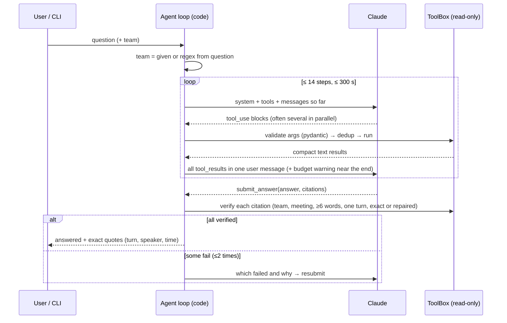

# Data flow

## Ingest of one meeting (e.g. TS3012c)
```mermaid
sequenceDiagram
  participant F as TS3012c.txt
  participant C as Code (parse/index)
  participant DB as SQLite
  participant L as Claude (extract)
  F->>C: read, parse header + turns, sha256
  C->>DB: unchanged hash? skip : replace turns, chunks, FTS rows
  C->>DB: regex self-introduction roles
  C->>DB: read TS3012a-b items
  C->>C: compute_state(a,b) → compact prior memory
  C->>L: system rules + prior memory + numbered transcript of c
  L-->>C: JSON (schema-constrained): summary, roles, items with thread/relation/related/evidence
  C->>C: validate kinds/threads/links (earlier only) / speakers; resolve every quote against c's turns
  C->>DB: one transaction: items, new threads, touched threads, summary, roles(source=llm)
  C->>DB: llm_calls row (tokens, latency, cost)
```

## Answering a question


## What crosses which boundary
| Data | Goes to the model? | Notes |
|---|---|---|
| One meeting's full transcript | Yes, at extraction only | Never more than one meeting per call |
| Team's prior memory (statements, ids, statuses) | Yes, at extraction | Bounded (60 threads × 6 items) |
| Tool results (snippets, items, turns) | Yes, in the agent loop | Each search capped (≤8 passages, turns truncated at 450 chars); `read_turns` ≤40 turns |
| Citations | **Generated by code** from stored turns | The model proposes; code cuts the exact substring |
| API key | Never logged or stored in the DB | Read from env / `.env` (gitignored) |
| Transcripts, questions, brief PDF | Never committed | `.gitignore` covers `data/`, `*.zip`, `*.pdf` |

## Retention
Everything is local: `var/memory.db` (turns, memory, LLM ledger without prompts or outputs) and `evaluation/results/` (agent traces with tool arguments and result summaries). Prompts are sent to the Anthropic API under the account's data policy.
